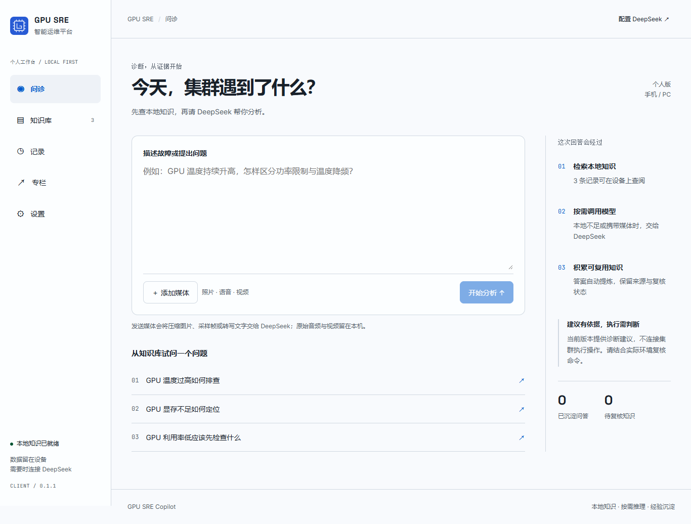
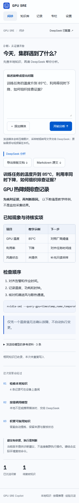

# GPU SRE Copilot

手机与 PC 共用 Vue3 界面的 GPU 运维问答客户端：**先查本地知识，不足时调用 DeepSeek，再将可复用摘要保存为待复核知识**。

[](LICENSE)

## 项目讲解

开发过程、各阶段代码讲解与图文教程，请到[公众号专栏阅读](https://mp.weixin.qq.com/mp/appmsgalbum?__biz=MzIyMDE3MzE2Mw==&action=getalbum&album_id=4642974900092256256#wechat_redirect)。

本仓库只提供代码、运行说明和必要的功能截图，不提供公众号文章正文、文章源稿、发布配图或素材包。公众号内容属于独立作品，不在本仓库 Apache-2.0 授权范围内。

## 快速运行

需要 Node.js 22（含 npm）。

```bash
git clone https://github.com/haozheyu/gpu-sre-copilot.git
cd gpu-sre-copilot/client
npm ci
npm run dev
```

打开终端显示的地址，点击“GPU 温度过高如何排查”，无需 Key 即可验证本地问答。仓库只附三条原创教学数据，不含个人数据库、真实凭据或私人安装包。

真实模型使用前，在应用“设置”填写自己的 DeepSeek Key。当前使用 `deepseek-flash`，实际能力以[官方文档](https://api-docs.deepseek.com/quick_start/pricing/)为准。浏览器若受跨域策略限制，请使用 PC 或 Android 客户端。

## 功能

- 本地 IndexedDB 知识与问答记录；中文词项检索，严格匹配后直接回答。
- DeepSeek 分析与摘要自动去重，摘要默认待人工复核。
- 照片本机压缩、语音本机 Whisper 转写、视频五帧采样后分析。
- 回答支持 Markdown 排版，导出可离线阅读的 HTML 或 Markdown 源文。
- Windows 系统加密存储、Android Keystore 与浏览器口令保险箱分别保存密钥。

应用不连接集群执行命令，没有自动修复、实时监控或双端云同步。视频仅采样五帧，不含音轨；语音首次转写需要下载模型。截图使用教学数据和模拟回答，不代表生产环境或手机真机验证。



<details>
<summary>手机宽度下的文档阅读界面</summary>



</details>

## 测试与构建

```bash
cd client
npm test
npm run build
npm run preview -- --port 5191 --strictPort
```

另开终端，在 `client` 目录运行 `npm run test:ui`。默认使用已安装的 Chrome；也可先 `npx playwright install chromium`，再设置 `BROWSER_CHANNEL=chromium`。通过 `APP_URL` 可修改预览地址。UI 检查不使用真实模型 Key，结果保存在忽略的 `evidence` 目录。

| 目标 | 命令或入口 | 条件 |
| --- | --- | --- |
| Windows PC | `npm run desktop:pack` | 先完成前端构建，产物位于 `client/release` |
| Android | `npm run android:sync`，打开 `client/android` | JDK 21、Android SDK 35，配置本机 `local.properties` 后运行 `gradlew.bat assembleDebug` |
| 浏览器 / PWA | 静态托管 `client/dist` | HTTPS 或 localhost；首次加载完成后本地知识可离线使用 |

Android 构建建议使用英文目录，例如 `C:/work/gpu-sre-copilot`。Debug APK 用于开发测试，商店发布需另行管理签名。iPhone 目前仅响应式网页，没有已验证的 iOS 原生包。原生设备行为仍需在目标手机验证。

## 代码位置

| 路径 | 用途 |
| --- | --- |
| `client/src` | Vue 页面、检索、模型、存储、媒体与文档渲染 |
| `client/electron` | PC 主进程和受限 IPC |
| `client/android` | Android 原生工程与 Keystore 插件 |
| `client/examples` | 三条可公开运行的样例知识 |
| `client/tools` | 初始化样例和 UI 检查 |
| `tools/check_public.py` | 检查公开文件边界、链接和凭据模式 |

## 许可证

Copyright 2026 haozheyu。

本仓库的软件和配套运行说明采用 [Apache License 2.0](LICENSE)，署名信息见 [NOTICE](NOTICE)。第三方依赖保留各自许可证。公众号文章及其发布素材为独立内容，不因这里提供入口而获得本仓库的许可。
